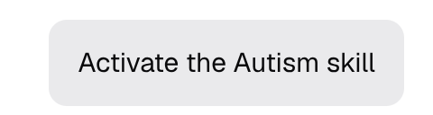

# i-have-autism

i-have-autism skill reshapes assistant output for a reader with Asperger autism: literal language, explicit certainty labels, frozen terminology, complete ranked detail, and a structure that never changes between turns.

## Installation

Use this prompt in your AI/CLI:

`Install the i-have-autism skill from https://github.com/kick-ban-ignore/i-have-autism. Make no mistakes.`

OR

Copy the `SKILL.md` into your skills directory, name must stay `i-have-autism`:

## Usage

- **`/i-have-autism`** — activates the mode for the rest of the session.
- **"stop autism mode"** or **"normal mode"** — deactivates it (the agent confirms in one line).

## License
Based on https://github.com/ayghri/i-have-adhd by Ayoub Ghriss 🧠

[MIT](./LICENSE)
